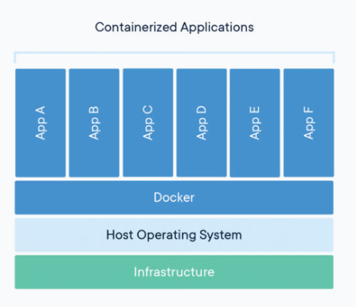
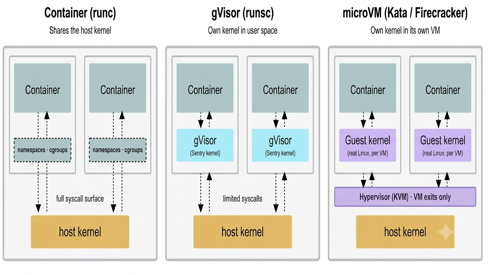
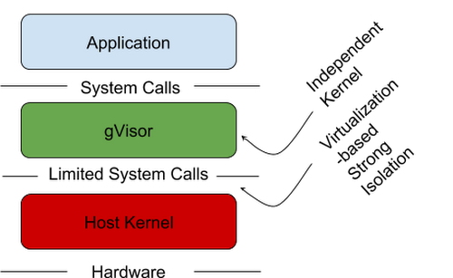
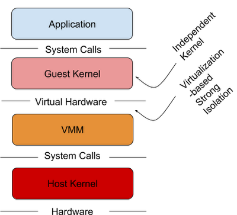

# AI Agent Sandboxing
This repository is to understand the problems of standard Docker containers not secure enough for AI agentic workloads . How this is handled by AI agent sandboxing.

Why are standard Docker containers not secure enough for AI agents? Is Docker safe enough to sandbox an AI agent that writes and runs its own code?
NO Docker containers share the host OS kernel — a kernel exploit in the agent’s generated code gives the attacker host-level access, not just container access.

Docker containers share the host OS kernel. That single fact is the entire argument. The industry requires a robust ecosystem of secure container technologies.



With traditional containers, the kernel imposes some limits on the resources the application can access. These limits are implemented through the use of Linux cgroups and namespaces, but not all resources can be controlled via these mechanisms. Furthermore, even with these limits, the kernel still exposes a large surface area that malicious applications can attack directly.

## Solution
What is AI agent sandboxing and how do Firecracker microVM, gVisor, and Kata Containers each approach it?
Sandboxing container runtime - sandboxed containers - containers that help provide a secure isolation boundary between the host OS and the application running inside the container.

AI agent sandboxing means executing AI-generated or AI-directed code inside an isolated environment with strict limits on filesystem access, network communication, and system calls. The goal is containment — stopping a compromised agent from affecting the host or other workloads when other controls fail. Sandboxing = give the agent a kernel boundary it cannot cross, so a compromise stays inside the agent's own box. Three approaches, same Kubernetes plug (runtimeClassName), different mechanism. RuntimeClass is the Kubernetes API object that specifies an alternate container runtime via the runtimeClassName field in the pod spec. It is the common entry point for both gVisor and Kata Containers.



Fundamentals:

runc — shares the host kernel.
gVisor — each agent a fake kernel in software.
microVM — each agent a real kernel in its own VM.

Concept: 

gVisor shrinks the door. A microVM builds a wall.

```
# RuntimeClass is defined in the node.k8s.io API group
apiVersion: node.k8s.io/v1
kind: RuntimeClass
metadata:
  # The name the RuntimeClass will be referenced by.
  # RuntimeClass is a non-namespaced resource.
  name: myclass 
# The name of the corresponding CRI configuration
handler: myconfiguration 
```

## gVisor



gVisor is more lightweight than a VM while maintaining a similar level of isolation. The core of gVisor is a kernel that runs as a normal, unprivileged process that supports most Linux system calls. This kernel is written in Go, which was chosen for its memory- and type-safety. Just like within a VM, an application running in a gVisor sandbox gets its own kernel and set of virtualized devices, distinct from the host and other sandboxes.

## microVM



One approach to improve container isolation is to run each container in its own virtual machine (VM). This gives each container its own "machine," including kernel and virtualized devices, completely separate from the host. Even if there is a vulnerability in the guest, the hypervisor still isolates the host, as well as other applications/containers running on the host.

Running containers in distinct VMs provides great isolation, compatibility, and performance, but may also require a larger resource footprint.

 Kata Container is an open-source project that uses stripped-down VMs to keep the resource footprint minimal and maximize performance for container isolation. Like gVisor, Kata contains an Open Container Initiative (OCI) runtime that is compatible with Docker and Kubernetes.

## References

Docker Sandboxes - https://www.docker.com/blog/why-microvms-the-architecture-behind-docker-sandboxes
Kubernetes Agent Sandbox - https://github.com/kubernetes-sigs/agent-sandbox
gVisor is an open-source, user-space application kernel developed by Google that provides a secure sandbox for running containers - https://gvisor.dev
microVMs - https://northflank.com/blog/what-is-a-microvm

